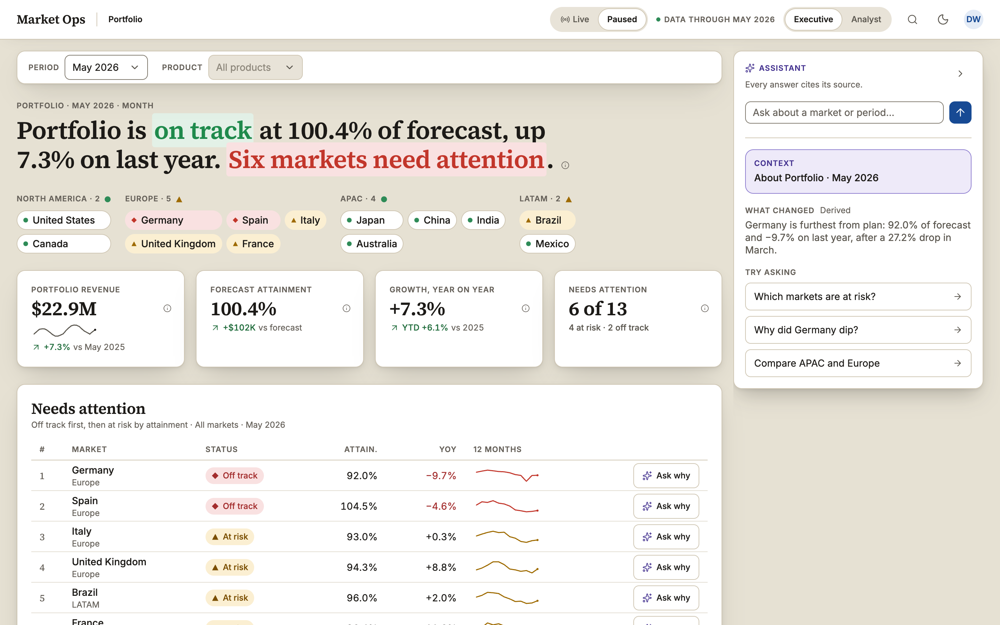
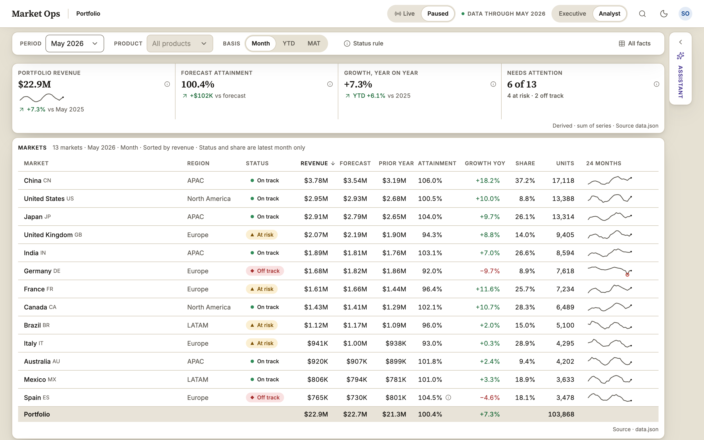
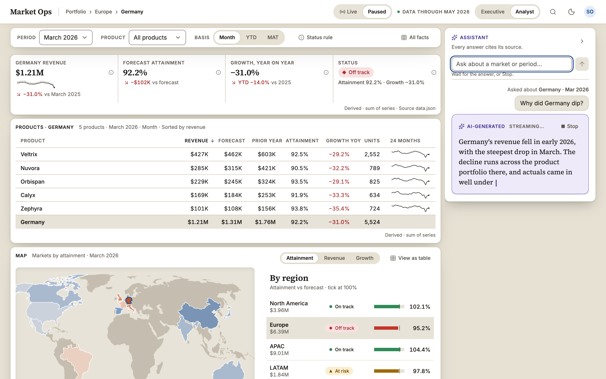
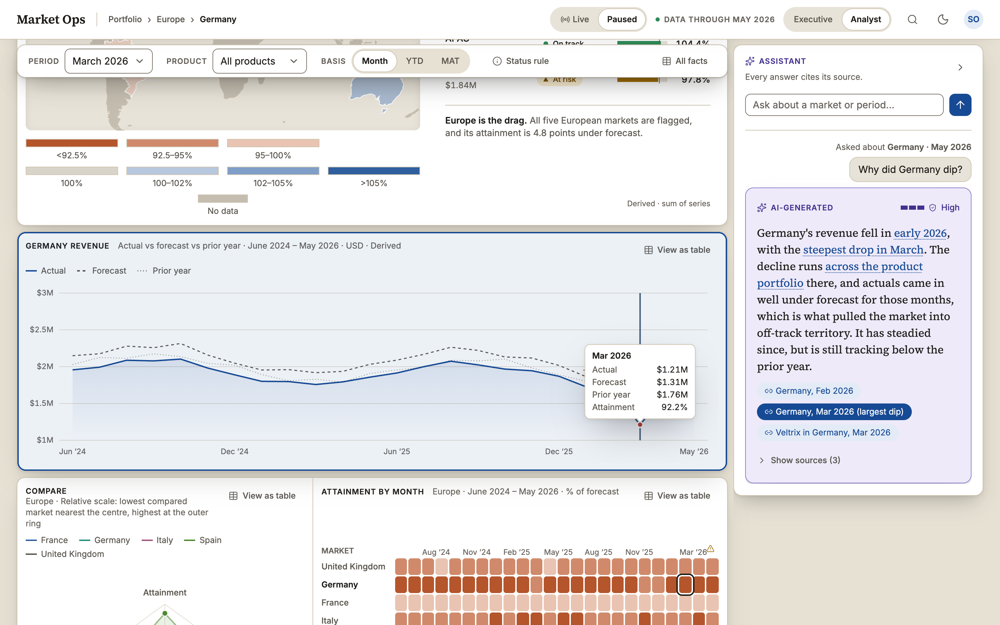
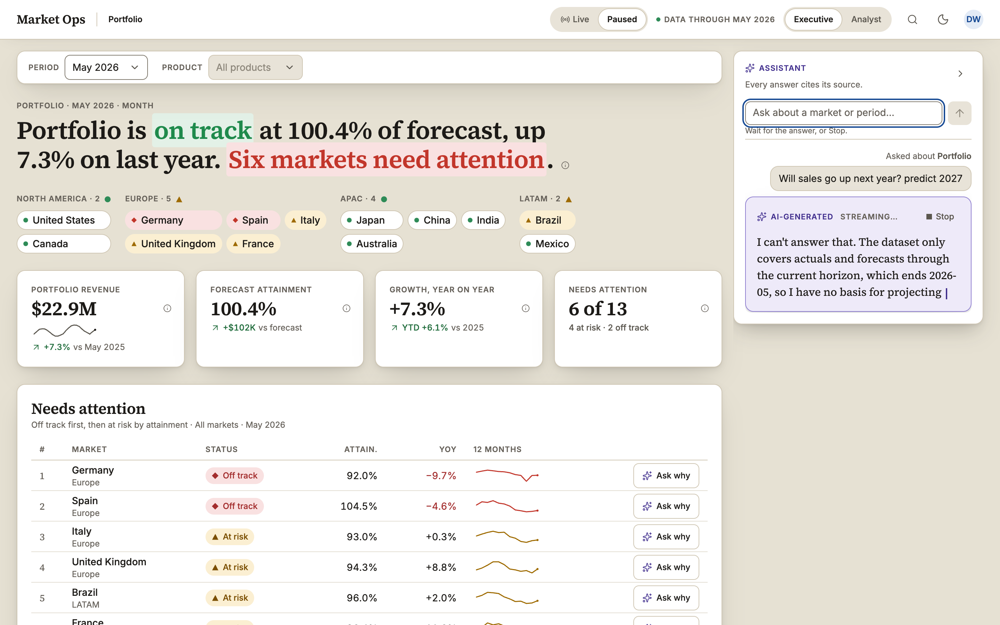
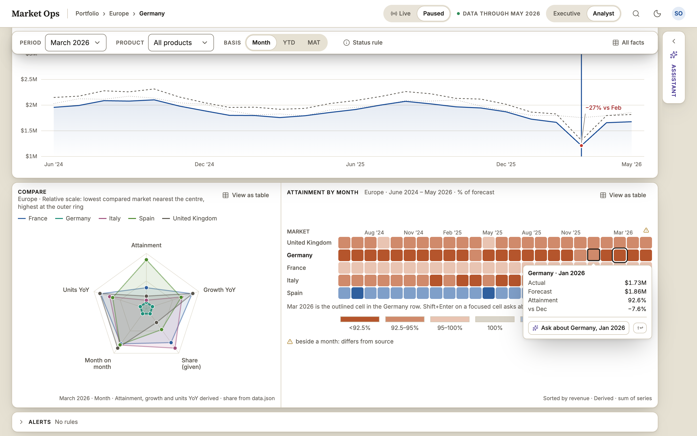
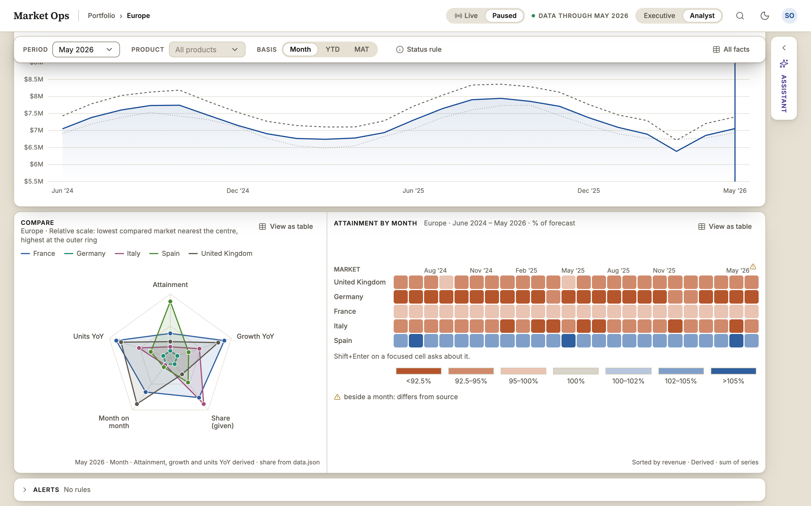
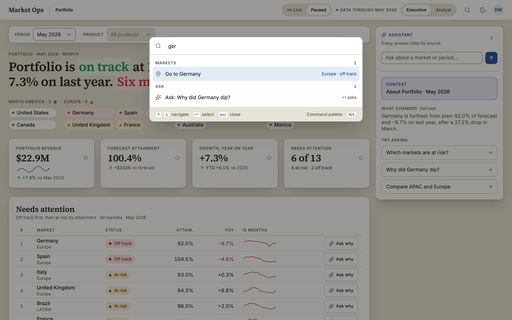
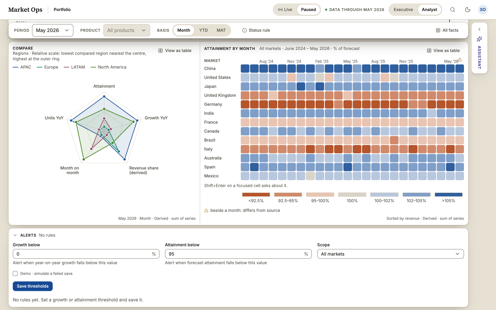
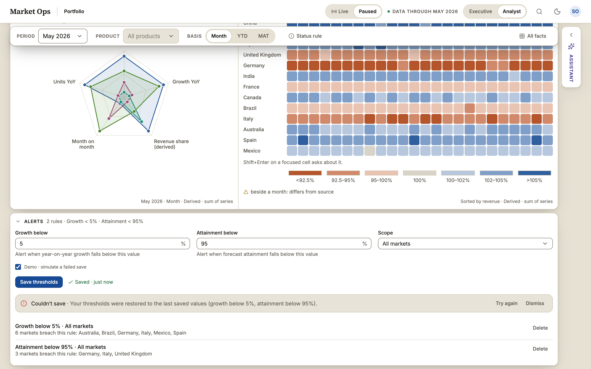

<!--
  TODO(Flavius): voice pass. The sections marked "TODO(Flavius): edit voice" were drafted from the documents in docs/
  and are factual; rewrite them in your own words before submitting. Two parts are yours alone and are left as
  placeholders: "How I used AI tools" (search for TODO(Flavius): W20) and the closing thoughts (TODO(Flavius): T3).
  Remove this comment when done.
-->

# Market Ops

A market operations console: portfolio performance, forecast attainment and an assistant.

**Repository:** https://github.com/flaviusraicea/market-ops-console

**Live deployment:** https://market-ops-console-bay.vercel.app/ (deployed manually: Git-triggered Vercel deploys are off in `vercel.json`, so a push builds nothing there; CI in GitHub Actions is the only automatic check)

**Scope:** Desktop is the target. Tablet and phone are a working first pass: the assistant is a bottom sheet, charts have table views; polish is under "with more time".

The sections below follow the order of the submission brief: a to k, then screenshots.

## a. Quick setup

- Node 22 (`engines` in `package.json`) and pnpm 10.

```bash
pnpm install
pnpm dev          # http://localhost:3000
```

| Script                               | What it does                                                          |
| ------------------------------------ | --------------------------------------------------------------------- |
| `pnpm dev` / `build` / `start`       | Next.js development server, production build, production server       |
| `pnpm lint` / `typecheck`            | ESLint (including layer boundaries) and `tsc --noEmit`                |
| `pnpm test`                          | All Vitest projects: `unit`, `stories`, `stories:dark`                |
| `pnpm test:unit` / `test:stories`    | Unit tests (jsdom) and Storybook stories in headless Chromium         |
| `pnpm test:e2e`                      | Playwright journeys with axe, against the production build            |
| `pnpm storybook` / `build-storybook` | Component workbench on port 6006, static build to `storybook-static/` |
| `pnpm check:contrast`                | Asserts every design-token contrast pair in both themes               |
| `pnpm check:radius` / `docs:a11y`    | Radius scale by role; the accessibility doc's generated tables        |
| `pnpm check:budget`                  | Bytes received per view against the budgets in `package.json`         |
| `pnpm run ci`                        | Every check above but `test:e2e`, in CI's order, plus the builds      |

Component tests are Storybook stories with play functions; `pnpm test:stories` runs them headless in Chromium. Run `pnpm exec playwright install chromium` once before the browser tests. CI runs Playwright as a separate step after `pnpm run ci`'s checks.

Design and architecture documents live in [`docs/`](docs/README.md).

## b. Architecture overview

<!-- TODO(Flavius): edit voice -->

Five layers with a one-way dependency rule, enforced by ESLint and tested in `tests/unit/boundaries.test.ts`: `app` (routes, layouts, route handlers) → `features` (data-aware screens: overview, analyst, assistant, alerts, live, palette, shell) → `components` (the design system: primitives, charts, one component per concept) → `lib` (framework glue: the URL hook, the stream client, formatting, telemetry) → `domain` (types, zod schemas, selectors and rules; depends on zod only). The domain has no React, no Next and no fetch.

Data flow: `data.json` is parsed once on the server with zod and cached; the page is a server component that reads the URL, computes typed view models and renders the card shells. Charts, the assistant and the alert form are client islands that receive those view models as props and never fetch the dataset. A write (a drill, a period, a mode) goes to the URL through one hook over nuqs; Next re-renders the server page with the new search params and the islands update. There is no page-wide loading skeleton: only the lazy Analyst sections have per-section placeholders of the same shape, so nothing shifts.

Server against client state: facts live on the server (dataset, view models); navigation state lives in the URL (`region`, `market`, `product`, `period`, `mode`, `metric`, `basis`, `cite`, `facts`, with invariants applied by one writer); identity is one cookie; the answer history, the streaming buffer and the live tick are React reducers in providers; the alert rules are the one piece of remote mutable state, held by TanStack Query with an optimistic save and rollback; preferences are in storage; everything else is local component state. There is no global store. The full account, with the folder tree, the URL schema, the contracts and the component tree, is in [`docs/architecture.md`](docs/architecture.md).

### Where each part of the brief lives in the code

Where each part of the brief lives in the code.

| Brief item                                               | Where                                                                                                                                                                                                                    |
| -------------------------------------------------------- | ------------------------------------------------------------------------------------------------------------------------------------------------------------------------------------------------------------------------ |
| Streaming chat, stop, in-progress states                 | `src/app/api/chat/route.ts` (SSE), `src/lib/stream/chatClient.ts`, `src/features/assistant/useAnswerMachine.ts` (the answer state machine, per-frame flush), `Panel.tsx`, `Composer.tsx`                                 |
| Typed event contract                                     | `src/domain/stream.ts` (`SseEventSchema`, `ChatRequestSchema`, `CitationSchema`), `src/domain/sseGuard.ts`                                                                                                               |
| Citations and the trust surface                          | `src/domain/citations.ts` (resolver), `src/components/CitationChip.tsx`, `src/features/assistant/CitationRow.tsx`, `SourcesTable.tsx`, `renderWithCitations.tsx`; landing in `src/features/analyst/useLanding.tsx`       |
| Confidence and abstain                                   | `src/components/ConfidenceMeter.tsx`, answer kinds in `src/features/assistant/AnswerCard.tsx`, the horizon check in `src/lib/stream/horizon.ts`                                                                          |
| AI against authoritative content                         | the violet AI surface (`--ai-*` tokens in `src/app/tokens.css`), provenance captions in `src/domain/provenance.ts` and `src/components/CardHeader.tsx`, "Differs from source" in `src/features/assistant/crossChecks.ts` |
| Drill-down and coordinated views                         | `src/lib/context/` (one URL hook, parsers, invariants, `hrefFor`), `src/features/shell/Breadcrumbs.tsx`, every chart's click-to-drill                                                                                    |
| Executive against Analyst                                | `src/features/overview/`, `src/features/analyst/`, density tokens in `src/app/tokens.css`, `src/lib/density.ts`                                                                                                          |
| Map, radar, time series, heat map, and their table views | `src/components/charts/` (`Choropleth`, `RadarChart`, `LineChart`, `HeatMap`, `ViewAsTable`, `useChartKeyboard`), geometry built by `scripts/build-geo.ts`                                                               |
| Server and client state                                  | `src/lib/dataset.ts` (server loader), view models in `src/features/*/viewModel.ts`, `src/features/alerts/useAlertSave.ts` (TanStack Query, optimistic save and rollback)                                                 |
| Schema-validated form                                    | `src/domain/alertRule.ts` (one zod schema), `src/features/alerts/AlertForm.tsx`, `src/app/api/alerts/route.ts`                                                                                                           |
| Formatting for a multi-market audience                   | `src/lib/format.ts` (the only place numbers, money, percentages and dates are formatted; lint-enforced)                                                                                                                  |
| Roles (mock SSO)                                         | `src/proxy.ts`, `src/app/api/session/route.ts`, `src/lib/roles.ts`, `src/app/sign-in/`                                                                                                                                   |
| Live mode                                                | `src/lib/live.ts`, `src/features/live/`                                                                                                                                                                                  |
| Design tokens and the component system                   | `src/app/tokens.css`, `src/components/`, `docs/design-system.md`, `scripts/check-contrast.ts`, `scripts/check-radius.ts`                                                                                                 |
| Observability and hardening                              | `src/lib/events.ts`, `src/lib/vitals.tsx`, `src/app/api/errors`, `src/app/api/vitals`, `src/features/shell/ErrorBoundary.tsx`, `src/lib/csp.ts`, `next.config.ts`                                                        |
| Tests                                                    | `tests/unit/`, `*.stories.tsx` beside each component, `tests/e2e/`                                                                                                                                                       |

## c. Productionising

<!-- TODO(Flavius): edit voice -->

- **Performance budgets.** JS budgets of 275 KB (Executive) and 325 KB (Analyst) gzip are a hard gate in CI (`scripts/check-budget.ts`, after the build), with a warning at 90 %; both sit at about 93 %, the warn band. Lighthouse CI (`.github/workflows/lighthouse.yml`, `lighthouserc.json`) asserts performance ≥ 0.9, accessibility ≥ 0.95, LCP ≤ 2.5 s, CLS ≤ 0.1, TBT ≤ 200 ms and script weight on both views, median of three desktop runs. Every Analyst widget, the alerts form, the map code, the answer card, the live engine and the palette are lazy chunks, each capped at 60 KB.
- **No jank while streaming.** Tokens collect in a buffer and are flushed once per animation frame (`useAnswerMachine.ts`), so an answer renders at most once per frame; chart transitions are CSS tweens and the panel's open and close animate one grid column. Frame-budget specs in `tests/e2e/perf/` run alone after the rest of the suite.
- **Client-side observability.** `src/lib/vitals.tsx` reports LCP, CLS and INP to `/api/vitals` in production (console in development); Vercel Speed Insights adds real-user vitals on the deployment. `reportError` (`src/lib/events.ts`) is the one place a failure is reported: widget boundaries, `window.onerror`, unhandled rejections, stream failures and failed fetches all write one JSON line and beacon it to `/api/errors`, rate-limited per page. Details in [`docs/performance-monitoring.md`](docs/performance-monitoring.md).
- **Resilience.** Each widget sits in its own error boundary, so a failing chart shows an inline notice and the page stays up; a boundary resets when the context it renders for changes, so a drill or a period change recovers a failed widget. Above the widgets, `app/error.tsx` catches what no widget boundary did and shows the console's own screen, with Try again (a refresh of the segment) and the error's digest as a reference; `app/global-error.tsx` covers the root layout. On the server, `src/instrumentation.ts` (`onRequestError`) writes every failed render, route handler or proxy call as the same JSON line as the browser's reports, with the digest, route, path and method, so both sides of one failure meet in one log search. The assistant handles loading, empty, partial (stopped), failed and offline states, with Retry; an offline notice appears when the network drops. The alert save is optimistic and rolls back on failure with a focused notice.
- **Safe rendering of the model's output.** Answer text is rendered as text nodes, never as HTML or Markdown; the only markup added is the citation anchors the app wraps around known phrases (`renderWithCitations.tsx`, tested in `tests/unit/safeRender.test.tsx`). Every stream event is validated in the browser by the zod-free guard in `sseGuard.ts` before it reaches state; a test holds the guard to `SseEventSchema`, and the route asserts the schema in development. A per-request nonce Content-Security-Policy (`src/proxy.ts`, `src/lib/csp.ts`) allows scripts only from this origin or with the nonce.
- **Built, served, cached.** `next build` produces the app; Vercel (fra1) serves it with `next start` semantics: the page is dynamic (`private, no-cache`, because the URL is the state and the role cookie picks the view), `/api/*` is `no-store`, `/_next/static` and the content-hashed `/geo/*` file are immutable. Security headers (`next.config.ts`) and the CSP go out with every response. Preview deployments are `noindex` (`VERCEL_ENV` is `preview`); a production build is indexable, deployed or local, so a local Lighthouse run scores SEO as the live site does.
- **CI/CD.** `.github/workflows/ci.yml` runs lint, format, typecheck, contrast, radius, the accessibility-doc check, unit and story tests, the build, the budget check, the Storybook build and the Playwright suite with axe on every push and pull request; `lighthouse.yml` runs Lighthouse CI. Branch protection requires both. Deploys are manual on purpose: Git-triggered Vercel deploys are off in `vercel.json`, so the live link only changes when a build that passed CI is promoted.

## d. Front-end approach & decisions

Each row gives the problem, the choice, and the alternative turned down with the reason. The full records are in [`docs/decisions/`](docs/decisions/).

| Problem                                                                                                                                                          | Choice                                                                                                                                                                                                                                                                                                                                                | Turned down                                                                                                                                                                   |
| ---------------------------------------------------------------------------------------------------------------------------------------------------------------- | ----------------------------------------------------------------------------------------------------------------------------------------------------------------------------------------------------------------------------------------------------------------------------------------------------------------------------------------------------- | ----------------------------------------------------------------------------------------------------------------------------------------------------------------------------- |
| A shared link must open on the right view at first paint, and the mock assistant and alerts need a server ([0001](docs/decisions/0001-nextjs-app-router.md))     | Next.js App Router: server components read the URL and the data, route handlers host `/api/chat` and `/api/alerts`                                                                                                                                                                                                                                    | A Vite SPA with a separate API: the first paint is blank until the client reads the URL, and there are two things to deploy                                                   |
| A distinctive look with accessible primitives and no ad-hoc CSS ([0005](docs/decisions/0005-shadcn-restyled-tokens.md))                                          | Design tokens as CSS variables in `tokens.css`, Tailwind v4 utilities over them, shadcn/Radix primitives restyled onto them, one shared component per concept; `pnpm check:contrast` checks every token pair in both themes                                                                                                                           | shadcn defaults, which look generic; primitives built from scratch, which means redoing Radix's focus and ARIA handling                                                       |
| Four chart forms, all themed by tokens and all reachable by keyboard and screen reader ([0002](docs/decisions/0002-visx-charts.md))                              | visx (d3 primitives rendered by React), with d3-geo for the map; one tooltip, one keyboard pattern and one View as table for every chart                                                                                                                                                                                                              | Recharts, which has no map or heat map and would mean two systems; ECharts, which draws to canvas and leaves no DOM to label; Nivo, which is heavy and brings its own theming |
| Actual against forecast and prior year over 24 months                                                                                                            | Time series: three lines, forecast dashed, the anomaly labelled; View as table lists the months                                                                                                                                                                                                                                                       | Bars, which make a trend over 24 periods harder to follow                                                                                                                     |
| A market's profile across five measures at once                                                                                                                  | Radar: attainment, growth, share, month on month and units YoY, each axis scaled from the lowest to the highest value shown; View as table lists the values                                                                                                                                                                                           | Grouped bars, which make a profile shape harder to compare across markets                                                                                                     |
| Where attainment sits geographically, and drilling into a region                                                                                                 | Choropleth from world-atlas 110m, filtered at build time to the 13 markets ([0007](docs/decisions/0007-map-data-world-atlas.md); world-atlas and topojson-client are build-time devDependencies, the browser ships d3-geo); status carries a glyph and text as well as colour, and markets are reachable by keyboard; View as table lists the markets | A hosted map or tile service, which needs a key and the network                                                                                                               |
| Spotting a pattern across markets and months ([0008](docs/decisions/0008-heat-map-over-scatter.md))                                                              | Heat map of markets by month, coloured by diverging attainment, which reads at a glance; a keyboard grid, and a cell click sets market and month in the URL; View as table lists the cells. Coordinated views come from click-to-drill in every view                                                                                                  | A scatter with a brush: over 13 markets a brush adds an interaction mode for little gain                                                                                      |
| Drill, period, mode and the open citation must survive a reload, a shared link and back/forward ([0003](docs/decisions/0003-url-state-nuqs.md))                  | The URL is the only navigation state, through nuqs typed parsers behind one hook that applies the invariants                                                                                                                                                                                                                                          | A client store synced to the URL, which gives two sources of truth; a hand-rolled `useSearchParams` wrapper, which is untyped and not readable on the server                  |
| Server state against client state ([0009](docs/decisions/0009-server-state-rsc-zod.md), [0004](docs/decisions/0004-tanstack-query-alerts-only.md))               | `data.json` is parsed once on the server with zod and reaches client islands as view models; TanStack Query holds only the alert rules and their optimistic save with rollback; UI state stays local to its component; no global store                                                                                                                | TanStack Query for all data, which fetches a static file on the client; a global store, which nothing needs beyond the URL                                                    |
| A non-trivial form whose rules hold on the server too ([0010](docs/decisions/0010-forms-react-hook-form-zod.md))                                                 | react-hook-form with one zod schema shared by the form, the route handler and the mutation                                                                                                                                                                                                                                                            | A native form with zod on submit, which needs hand wiring for inline errors per field                                                                                         |
| A non-trivial assistant surface without a model                                                                                                                  | `/api/chat` streams scripted fixtures as Server-Sent Events: deterministic, offline and testable. A real LLM would plug in behind the same event contract                                                                                                                                                                                             | Calling a hosted model, which needs a key, costs per request and makes tests and demos non-deterministic                                                                      |
| Tests for logic, components, journeys and accessibility ([0006](docs/decisions/0006-storybook-component-tests.md), [0011](docs/decisions/0011-testing-stack.md)) | Vitest for domain logic, Storybook stories with play functions and axe in real Chromium for components, Playwright with axe against the production build for journeys                                                                                                                                                                                 | Jest with Testing Library in jsdom, which has no real layout, focus or CSS to test against                                                                                    |
| Bundle size must not creep back after tuning                                                                                                                     | Budgets: 275 KB Executive / 325 KB Analyst gzip, hard fail; derived from Lighthouse ≥ 90 on throttled mobile plus 10% headroom                                                                                                                                                                                                                        | Warning-only, which is no gate; tracking the current size, which means churn                                                                                                  |
| A selected row must read as selected without competing with a citation landing                                                                                   | Every selected row (product, region, market) gets a `--surface-2` background, a semibold name and `aria-current="true"` (`aria-selected` is on chart cells only), with no accent edge; the 2 px accent ring is left to a landed citation                                                                                                              | A 3 px accent side stripe: a coloured side stripe is the one decoration the design bans, and it made a selection look like a citation                                         |

## e. Accessibility

<!-- TODO(Flavius): edit voice -->

Target: WCAG 2.1 AA. The full reference, with the recorded Tab order, the shortcuts and the contrast table, is [`docs/accessibility.md`](docs/accessibility.md); its tables are generated from the tests and the tokens and drift-checked in CI (`pnpm docs:a11y --check`).

- **Keyboard.** A skip link, a documented Tab order on both views, and one pattern for every chart: the chart is one tab stop and the arrow keys move inside it (markets on the map, cells in the heat map, months on the line). The palette (Ctrl/⌘ K), the assistant and the dialogs trap and return focus; Escape always returns focus to what opened the surface. Focus rings are visible on every control and survive forced colours.
- **ARIA and screen readers.** Landmarks and a heading outline per view; `aria-live` status for "Streaming…", "Answer complete" and the save result; tables with proper headers; the status of every market is read as text ("Germany, off track"), never as colour alone; each popover takes its trigger's name. In the Analyst grid the market or product name is the link that drills in, with the address the drill would write, so a screen reader hears a link with a destination and the address can be copied; a click elsewhere on the row does the same with the mouse. Rows are not tab stops, and the selected product row carries `aria-current`.
- **Colour and contrast.** Every text pair holds 4.5:1 and every graphic pair 3:1 in both themes, asserted by `pnpm check:contrast` in CI; status always carries a glyph and a word as well as a colour; the heat map's diverging scale has a legend and a table view.
- **Reduced motion.** The OS setting and an in-app switch zero the transitions, the stream still renders, the live dot stops pulsing.
- **Accessible alternatives for charts.** Every chart (map, radar, line, heat map, sparklines) has View as table, an SVG title and description, and keyboard-reachable data points with a tooltip that is also read by assistive technology.
- **Checked.** axe (`wcag2a`, `wcag2aa`, `wcag21aa`) with zero violations on the main screens in light and dark, in the Storybook stories and in the Playwright journeys; Lighthouse accessibility 100 on every route.
- **What I'd add.** A VoiceOver and NVDA pass by hand, Safari and Firefox checks, and the WCAG 2.2 target-size rule as a CI gate.

## f. Testing

<!-- TODO(Flavius): edit voice -->

- **Unit (Vitest, jsdom):** domain selectors with real numbers, the citation resolver, the alert evaluator, URL parsers and invariants, formatters, SSE parsing and token batching, the answer and alert-save state machines, the route handlers, safe rendering of model output, the no-LLM dependency check and the layer rules (`tests/unit/`, 66 files, 601 tests).
- **Contracts:** `DatasetSchema` against the real `data.json`, `fixtures.json` against its schema, the stream guard against the zod schema, the chat request with and without a view.
- **Component (Storybook + Vitest browser mode):** 167 stories, 148 of them with play functions, run headless in Chromium, once in light and once in dark, with the a11y addon failing on any violation (334 story tests). Stories cover every component with states or variants; primitives are exercised through their parents' stories.
- **End to end (Playwright with axe, against the production build):** one spec per feature, 42 specs; the happy paths (ask, stream, stop, cite, drill, alert save and rollback, palette, live) plus keyboard, forced colours, reduced motion, offline and the five-width scroll check; frame-budget specs run last, alone, never retried; in CI they are an advisory step (annotations on the run, `continue-on-error`), because frame timing on a shared runner is evidence, not a gate, while locally `pnpm test:e2e` still fails on a stall. The suite has no fixed sleeps: every wait is `expect.poll` on the state in question.
- **Gates that are not tests but fail the build:** contrast pairs, the radius scale, the generated accessibility tables, the bundle budgets, Lighthouse CI.
- **Deliberately skipped:** visual-regression snapshots (the stories and the e2e assertions check layout facts instead, and snapshots churn on every design change); cross-browser runs (Chromium only, by time); mutation testing; load tests (there is no backend to load).

## g. Key technical decisions

<!-- TODO(Flavius): edit voice -->

One record per decision, with the context, the choice and the consequences, in [`docs/decisions/`](docs/decisions/). The ones that shaped the build most:

- [0001](docs/decisions/0001-nextjs-app-router.md): Next.js App Router: the server reads the URL and the data, so a shared link opens on the right view at first paint.
- [0003](docs/decisions/0003-url-state-nuqs.md): The URL is the only navigation state, written through one hook that applies the invariants (market implies region, product needs a market).
- [0009](docs/decisions/0009-server-state-rsc-zod.md): The dataset is parsed once on the server with zod and reaches client islands as typed view models; a malformed `data.json` fails CI.
- [0004](docs/decisions/0004-tanstack-query-alerts-only.md): TanStack Query holds the alert rules only, with an optimistic save and rollback; facts are never fetched on the client.
- [0005](docs/decisions/0005-shadcn-restyled-tokens.md): shadcn/ui and Tailwind v4 restyled onto our tokens; no raw hex outside `tokens.css`.
- [0002](docs/decisions/0002-visx-charts.md): visx for all four charts, so there is one tooltip, one keyboard pattern and one View as table.
- [0007](docs/decisions/0007-map-data-world-atlas.md): Map geometry from world-atlas, filtered to the 13 markets at build time; nothing of it ships to the browser.
- [0008](docs/decisions/0008-heat-map-over-scatter.md): A heat map as the fourth view, over a scatter with a brush.
- [0010](docs/decisions/0010-forms-react-hook-form-zod.md): react-hook-form with one zod schema shared by the form, the route handler and the mutation.
- [0006](docs/decisions/0006-storybook-component-tests.md): Storybook stories with play functions and axe as the component test harness.
- [0011](docs/decisions/0011-testing-stack.md): Vitest for logic, Storybook for components, Playwright with axe for journeys, and the contrast check as a CI gate.
- [0013](docs/decisions/0013-performance-budgets.md): Bundle and Core Web Vitals budgets enforced in CI, per view.
- [0014](docs/decisions/0014-content-security-policy.md): A per-request nonce Content-Security-Policy and the standard security headers.
- [0012](docs/decisions/0012-deploy-vercel.md): Vercel, with Git-triggered deploys off; a deploy is started by hand.
- [0015](docs/decisions/0015-chrome-ignores-density.md): The chrome (header, toolbar, assistant panel, palette) looks the same in both densities.

## h. Engineering standards

<!-- TODO(Flavius): edit voice -->

Followed: strict TypeScript with no `any` and `noUncheckedIndexedAccess`; zod contracts at every boundary (dataset, stream events, chat request, alert rule, error report) with types inferred from them; a layer dependency rule enforced by ESLint and tested; one component per concept and tokens only (literal colours and radii are lint and script failures); Conventional Commits, one branch and one pull request per change, merge commits, branch protection with CI required; Prettier as the one formatter; every CI gate listed above; workflows run with `permissions: contents: read` and cancel a superseded run of the same branch (`concurrency`); an ADR per decision in [`docs/decisions/`](docs/decisions/).

Skipped, knowingly: the React Compiler is not enabled (explicit memo discipline and the boundaries test instead; enabling it is a with-more-time item); GitHub Actions are pinned to major tags, not SHAs (there is no Dependabot to keep SHAs current: it would open pull requests on the submission repo after hand-in); the default Next browserslist (a modern target would drop about 13 KB of polyfills); Chromium only in automated tests; two hand-written validators (`sseGuard.ts`, `alertRule.ts`) shadow their zod schemas on the client, to keep the schema library (about 26 KB) out of the first load; the tests hold them to the schemas.

## i. How I used AI tools

I used this project to try the new Projects feature in the Claude desktop app for Mac. In theory at least, it's set to become the new way of working with agents: one project that coordinates the work, instead of a separate chat for every feature. It's a simplified version of the setup I normally use, a multi-agent system backed by an Obsidian second brain / knowledge vault, which I mostly run from the CLI. I split the roles as follows: Opus 5.5 as the project coordinator, Fable 5.1 as advisor and spec author, and Sonnet 5.5 for implementation.

I started with a rough MVP and built up from there. The first goal was to get the Executive and Analyst views working properly end to end, with clean foundations underneath. Polish only came once both held up, and the stretch goals were the last thing I added.

The building workflow:

```
 ME: product owner, approves every decision
        │
        ▼
 COORDINATOR (Opus 5.5)
  routes work, keeps project memory,
  forms recommendations with Fable ── proposal ──► me: yes / no
        │ approved
        ▼
 FABLE 5.1 (design + spec author)
  design system, mocks, slice specs with acceptance
  criteria as observable outcomes, tests first
        │ approved spec only
        ▼
 SONNET 5.5 EXECUTORS (one per slice or fix, no design calls)
  one branch + one PR each; ambiguity goes back to the coordinator
        │
        ▼ local gates: typecheck · lint · unit · stories + a11y
          · build · bundle budget · contrast · radius · a11y-docs drift
        ▼
 PR (template) ── CI: e2e + axe + Lighthouse ── Opus PR review
        │
        ▼ I approve the merge
        ▼
 main ─► local build pulled and rebuilt for me to check
```

The working principles:

1. **I decide, agents propose.** Every decision came to me as an explicit yes or no. Silence never counted as approval, and nothing started without my go-ahead.
2. **Design decisions only by Fable or Opus, never Sonnet.** Sonnet executors only built specs I had approved.
3. **Spec first, tests first.** Each slice had acceptance criteria written as observable outcomes before any code.
4. **One change, one small PR.** It merged only after local typecheck, lint, unit tests, build and the bundle budget passed, and non-trivial PRs also got an Opus review.
5. **Never touch the starter data** from the brief.
6. **Accessibility and design quality are part of the definition of done.** That meant WCAG 2.1 AA, Storybook stories counting as tests, and the goal that it must not read as vibe-coded.
7. **Always verify on the latest main.** Localhost was pulled and rebuilt after every merge before any testing.
8. **Process files stay out of the repo.** Specs and reports lived in the project's shared folder.

After polishing up to the point where I was satisfied with my solution, I did a final audit of the app. Fable led it at high effort and had the final say on every finding. It covered:

- the full automated suite in a clean environment: unit tests, Storybook interaction and accessibility tests, Playwright end-to-end tests with axe, Lighthouse, and the bundle budgets
- an independent code review
- a point-by-point check against every requirement in the brief
- a manual pass in Chrome on my Mac through computer use

While that was running, I tested the whole app myself and reviewed the documentation.

The findings came back as a prioritised fix list in tiers. I chose which tiers to act on, the executors fixed them as small PRs through the same gates as before, and the app was re-audited afterwards to confirm the fixes held.

## j. What I'd do differently with more time

- JS budgets 275/325 KB gzip are enforced in CI (warning at 90%); both views sit at about 93 %, the warn band. The Lighthouse resource budget in `lighthouserc.json` is the CI budget plus a 10 KB allowance for response headers and Vercel's injected script. With more time: trim the bundle with visx tree-shaking and a d3-geo projection subset, and move static card shells to server components.
- The assistant is scripted on purpose: `/api/chat` streams fixture answers over Server-Sent Events, with no LLM behind it. A real model would plug in behind the same `/api/chat` event contract.
- Numbers, money and month names use one fixed locale, en-US, and USD, the data's currency, so output is the same in every test, screenshot and browser (`src/lib/format.ts`). A real product would take the locale from the user.
- Following a citation from Executive to Analyst mounts the Analyst view in one long task: about 170 to 210 ms at 4× CPU slowdown and about 50 ms at 1×. The panel animation and the facts-table scroll run near 30 fps at 4× CPU throttle; the period select and the palette's first mount show single long tasks at 4× on slow machines. Streaming an answer reports a layout shift of about 0.07 as the card grows. The first answer also loads a zod chunk (about 26 KB) that parses the dataset for the sources table (the stream itself is validated without zod), so it starts a little later than the following ones. Drilling replaces the region strip (four cards, then one, then none on the market view); on slow CPUs that reflow lands after the input window and can count as CLS. With more time: split the static card shells into server components so less of that mount runs on the client, and give the market view a same-height one-row region summary so the drill reflows nothing.
- The client receives the dataset without its fact series (`lightDataset`), typed as the full `Dataset`; a domain function that reads series on the client would return zeros rather than fail to compile. It cannot happen with the fixed starter data, but with more time the light shape gets its own type so the compiler enforces it.
- Inline citation anchors and the "Differs from source" cross-checks are keyed by the known answers' citation labels, because the stream's `done` event carries no answer id. A real model would keep the chips and the sources table and lose the inline anchors; citation spans in the event contract are the next step.
- Automated tests run in Chromium; with more time: a VoiceOver and NVDA pass and Safari/Firefox checks.
- `reportError` writes one JSON line per failure and `/api/vitals` one per vital, both to the server log. With more time: feed `reportError` to Sentry, which is one init call plus the DSN.
- With more time: fold the Markets table's sparklines into the row at docked widths (assistant panel open), so the table keeps its trend column when it narrows.
- With more time: stack the Analyst rows at docked widths of 1152 px and below. There the radar now draws near its minimum size (a 36 px spoke at 1024 px).
- With more time: the Analyst toolbar's More menu. Below 1200 px the toolbar scrolls sideways as a fallback; a More menu would fold the lowest-priority controls instead.
- KPI tiles use three rows (value, change, caption). The four-row grammar in the design notes was dropped because the three-row tile reads cleanly.
- Compare shows the five markets of the selected region. A market picker and a `compare=` parameter are the next step: up to four markets on the radar (spec written), with a legend that dims a series.
- With more time: at narrow widths (under 40 rem of card, as with the docked assistant) transpose the Attainment table to months as rows and markets as columns, scrolling vertically. A 24-column table can only scroll sideways there. Today it scrolls horizontally inside the fixed-height box; the Compare table already shortens its heads.
- With more time: with the assistant docked at 1440, the Compare table scrolls sideways; a denser two-line layout is planned.
- With more time: the radar should use a fixed portfolio-wide scale per axis with a reference ring, so shapes stay comparable whichever markets are compared. Today each axis is scaled between the lowest and highest compared value.
- With more time: citation chips on grid rows and KPIs should scroll to the matching time-series row.
- With more time: the assistant panel animation runs at about 30 fps on a 4× slower CPU during the 400 ms move (clean at 1×). Next step: freeze table column widths and contain the cards during the transition.

## Stretch goals

The brief lists five optional stretch goals. All five are built.

- **Live mode.** The `Live` toggle in the header starts a 5-second simulated tick that moves the latest month without losing the drill path or selection (`src/lib/live.ts`, `src/features/live/`; details under "Live mode notes" in the appendix).
- **Virtualised dense table.** The Analyst view's facts table renders the dataset's fact rows (1,560 in the data file) through TanStack Virtual (`src/features/analyst/FactsTable.tsx`); open Analyst mode, press **All facts** in the toolbar (it then reads **Hide facts**) and scroll the table. The table follows the current drill, so it can show fewer rows than the file holds.
- **Context-aware assistant.** The assistant knows which view you are on: the market or region you have drilled into and the selected month. That context is sent along with each question, so "Why is revenue down?" asked on Europe in March is answered about Europe in March, with citations, while the same question asked on the portfolio is answered about the portfolio. You do not have to type the context yourself (`src/features/assistant/`; see "Try it" in the appendix).
- **Command palette.** `Ctrl` / `⌘` + `K` opens a palette that jumps to any market or product (`src/features/palette/`).
- **Storybook.** Stories for the core components live beside each component (`*.stories.tsx`); run `pnpm storybook`, or open the hosted build at https://market-ops-console-storybook.vercel.app/.

## k. In my own words

I tried to tackle this assignment from first principles. I had never built a market operations console, but in its design it is close to a trading console, and I used what I know about those to shape the design system. The most important thing on a platform like that is trust, and that became the core idea of the project.

From there the work went in this order. First I broke down the domain layer, to understand the product and who uses it, an executive who needs a verdict in seconds and an analyst who needs exact, traceable numbers. From that I built the design system around the one principle. The data is dense and part of it comes from an assistant, so the user has to know at every step which numbers are true to the source and which are the assistant's output, even though the assistant is mocked for this exercise. Facts and interpretation sit on separate surfaces, and where the two disagree, the dashboard wins.

Within those rules I allowed myself one thing, a bit of depth on the surfaces, so the console feels less flat than most of its category without giving up any of its discipline. This is where the AI and I disagreed most. It held to the research we had done together, which says these tools are flat, and pushed back. The research was right about what exists, but what the category could look like is a call I would rather make myself.

What went right is easy to name. I split the build into the Executive and Analyst views and wrote specs for every use case of each, and once that planning was done the first working version came together very fast and needed almost nothing from me beyond the yes or no on each proposal. The workflow I describe under "How I used AI tools" carried that all the way through. And because the project ran in the cloud, I could answer a decision from my phone while out, and the build kept going.

What I'd do differently is mostly about process. Sometimes decisions were made in the Sonnet builder threads that should have been made by me or by Fable, maybe partly because the Projects feature is still in beta. Next time I'd draw that line more tightly from day one.

If you want the reasoning behind any of this, the [docs folder](docs/README.md) is where I'd send you first.

## Screenshots

Taken on the production build at 1440 px (2×), light and dark, in [`docs/screenshots/current/`](docs/screenshots/current/).

| View                                                            | Light                                                                                     | Dark                                                           |
| --------------------------------------------------------------- | ----------------------------------------------------------------------------------------- | -------------------------------------------------------------- |
| Executive overview: verdict, KPIs, map, regions, attention list |                  | [dark](docs/screenshots/current/overview-dark.png)             |
| Analyst: ledger, radar, heat map, time series, facts            |                              | [dark](docs/screenshots/current/analyst-dark.png)              |
| A streamed answer with confidence, citations and sources        |  | [dark](docs/screenshots/current/analyst-panel-answer-dark.png) |
| Following a citation: the chart lifts, the month is pinned      |            | [dark](docs/screenshots/current/citation-landing-dark.png)     |
| An honest abstain                                               |                              | [dark](docs/screenshots/current/abstain-dark.png)              |
| Heat map tooltip and the "Differs from source" mark             |             | [dark](docs/screenshots/current/heatmap-tooltip-dark.png)      |
| Radar compare                                                   |                  | [dark](docs/screenshots/current/radar-compare-dark.png)        |
| Command palette                                                 |                      | [dark](docs/screenshots/current/palette-dark.png)              |
| Alert thresholds form                                           |                      | [dark](docs/screenshots/current/alerts-form-dark.png)          |
| A failed save, rolled back                                      |               | [dark](docs/screenshots/current/alerts-failed-save-dark.png)   |
| Offline notice                                                  | [light](docs/screenshots/current/offline-notice-light.png)                                | [dark](docs/screenshots/current/offline-notice-dark.png)       |
| Not found                                                       | [light](docs/screenshots/current/not-found-light.png)                                     | [dark](docs/screenshots/current/not-found-dark.png)            |

<!-- TODO(Flavius): short video walkthrough, if time permits: add the link here. -->

## Appendix: notes on the app

Behaviour that is not in the brief but that a reviewer will meet.

### Try it

- `Which markets are at risk?` shows the "Differs from source" note: the assistant says 3 markets are at risk, data.json says 4 at risk and 2 off track.
- `Why did Germany dip?` shows a sourced answer with a High confidence meter and clickable citations.
- `Compare APAC and Europe` streams a comparison answer.
- `Which markets are at risk?` asked at `/?region=eu` answers about Europe's five markets only; open Germany in Analyst mode and ask `Why did revenue dip?` to get that month's numbers.
- `What will sales be next year?` is the abstain demo: the assistant declines, says what the data covers and offers a question it can answer.

### Assistant notes

- Answers stream from `POST /api/chat` (Server-Sent Events) and can be stopped; a stopped answer keeps its text, is marked partial and carries no citations or confidence.
- Every question carries the view it was asked from (entity and month, shown in the question echo), and the mock backend answers about that view: the same question gives a different, cited answer in Europe than in the portfolio. The backend is still a fake: no model and no retrieval. The keyword matcher is a fixture router (`src/lib/stream/pickFixture.ts`): it picks the canned answer for the question and the current view, and for one template answer fills in numbers read from `data.json`. The event contract is the boundary a real model would plug in behind; the router is the part that would go.
- The conversation is kept in this tab's session storage (key `mo.conversation:v1`): a reload keeps the conversation, a new tab starts empty. Sign-out clears it. What is stored is parsed against a zod schema of the contract types it is made of, and an entry of another shape is dropped; citations are stored as they came off the wire and resolved again on restore. The schema module loads only when there is something to restore, so zod stays out of the first paint.

### Data

`src/data/data.json` is the starter pack's file, unchanged. `src/data/fixtures.json` keeps every starter answer, kind and the `default` byte for byte; what changed:

- The top-level `note` describes the matcher as it is now (scope preference and templates).
- Three keyword sets were widened so the brief's questions match in more phrasings: `at-risk`, `apac-vs-europe` (which now requires one word from each side: APAC or Asia, and Europe) and `forecast-miss`.
- Four fixtures were added: `at-risk-europe` (the at-risk answer for the Europe view, so the same question is answered about the five European markets), `dip-any-market` (a template answer for "why did revenue dip" in any market view, filled from `data.json`), `off-topic` (an honest abstain for questions the data cannot answer) and `why-status` (an abstain for "why" questions about a status: the data holds the status, not the reason).

### Data inconsistency: reported vs summed attainment

For May 2026 `data.json` states each market's forecast attainment twice: in `kpis` (the reported figure) and implicitly in `series` (actual over forecast, summed over the market's products). They disagree for all 13 markets, by up to 1.1 points. Revenue and growth agree. Neither is changed. The reported figure leads everywhere a headline is shown (KPI tiles, verdict, badges, narrative, Markets table). Where a sum is the point, the footer of a market's products table and the heat map cells for the latest month, the sum is shown with a "Differs from source" warning mark and the note `Series sum 93.8% · reported KPI 93.0%`. The Attainment tile's money delta is the series' own variance, so it carries the same mark. The heat map marks its latest column once, in the header, with a legend line.

| Market         | Reported KPI | Series sum |
| -------------- | ------------ | ---------- |
| United States  | 100.5%       | 100.6%     |
| Canada         | 102.1%       | 101.8%     |
| Germany        | 92.0%        | 92.2%      |
| United Kingdom | 94.3%        | 94.6%      |
| France         | 96.4%        | 96.7%      |
| Italy          | 93.0%        | 93.8%      |
| Spain          | 104.5%       | 104.7%     |
| Japan          | 104.0%       | 104.2%     |
| China          | 106.0%       | 106.6%     |
| India          | 103.1%       | 104.2%     |
| Australia      | 101.8%       | 101.5%     |
| Brazil         | 96.0%        | 95.5%      |
| Mexico         | 101.0%       | 101.6%     |

### Roles (mock)

- You are signed in automatically as **Executive** (Dana Whitfield). The avatar at the right of the header shows who you are and switches to **Analyst** (Sam Okafor) in one click; `Sign out` opens a mock SSO screen with the two personas. Both roles see every page and all of the data.
- Auth is a mock SSO: sign-out clears the session and the next visit signs you in again as Executive.
- The role changes three things: the view a URL without `mode` opens on (`/` is the Executive overview for an Executive and the Analyst deep-dive for an Analyst; a `mode` in a shared link always wins), whether alert rules can be edited, and the sign-in screen. Executives read the rules; the fields are disabled and `POST`/`DELETE /api/alerts` answer `403 read_only_role`, so the rule holds where the data is written, not only in the UI.
- Nothing about it is real: no password, token or server session. The role is one cookie (`market-ops-role`, set by `src/proxy.ts` on a first visit and changed by `POST /api/session`).
- Real SSO would add an OIDC provider, a server session and role claims in the token. Region scoping would come with it: a Regional lead would see only their region's markets, and the Context invariants already make that a one-line filter in `marketsIn`.

### Alert notes

- Analyst mode has an `Alert thresholds` card (read-only when you are signed in as Executive; see Roles). Saving writes a growth rule and an attainment rule for the chosen scope through `POST /api/alerts`; saving the same metric and scope again updates the rule.
- The alerts backend is a mock: `POST`/`DELETE /api/alerts` validate, wait 600 ms and can fail, but store nothing. Rules are saved in your browser (`localStorage`, key `market-ops:alerts:v1`), so they survive a reload, stay in this browser only, and stay in step across tabs. If storage is disabled or full they last for the session.
- The `QueryClient` is one module-level instance made on first use, not a piece of the folded section's state: a save still in flight when the Alerts section folds keeps its cache and rollback, and the failure notice is read back from the mutation cache when the section opens again.
- The `Demo · simulate a failed save` checkbox sends `?fail=1`, so the route answers 500 after its 600 ms delay and the UI shows the rollback.

### Live mode notes

- The `Live` toggle in the header (in the Analyst toolbar below 768 px) starts a 5 second tick. Each tick moves the latest month's revenue and units for every market by up to ±0.1 %, never more than ±0.3 % from `data.json`, so no status flips within a minute. Only the latest month ticks; a past month is never revised. Pause freezes the simulated figures where they are until a reload. The numbers are simulated: nothing is fetched, nothing is saved, and a reload returns to the real data.
- Live mode is a client-side overlay. `applyLiveOverlay(dataset, tick)` in `src/lib/live.ts` is pure and seeded by the tick, so tests and stories replay the same sequence. The server still renders from `data.json`; when Live is first turned on the browser loads the full dataset in a lazy chunk and recomputes each widget's view model with the same functions the server uses.
- While live, a market's status is recomputed from its moved figures with the published rule (off track when growth is negative or attainment is below about 92.5 %; at risk below 100 %). This is the only place the app derives a market's status; captions read `Derived · live`.
- The URL, drill path, selection, open rail, palette and conversation are untouched. The assistant does not see the overlay and keeps answering from the saved data; the composer says so.
- Pausing freezes the figures. A hidden tab skips ticks. Under reduced motion values swap instantly and the pulsing dot is static.
